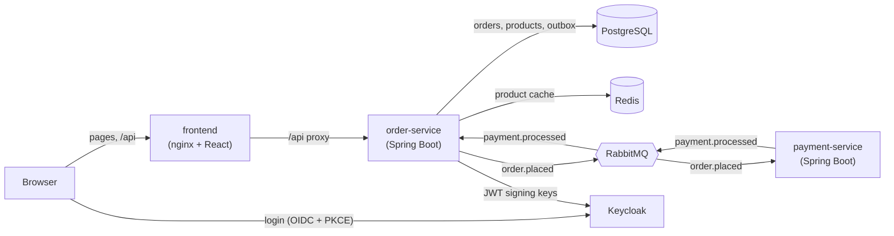

# Orders

An order-processing demo built to learn a typical enterprise stack end to end:
Spring Boot microservices that talk over RabbitMQ, JPA/Hibernate on PostgreSQL,
Redis caching, Keycloak for authentication, a React + TypeScript frontend, Docker
for running everything, and GitHub Actions for CI.

A customer logs in, adds products to a cart and places an order. The order service
stores it and publishes an event; the payment service "charges" the order (3 seconds,
1 in 6 payments is declined) and publishes the result; the order service marks the
order paid or failed, and the frontend shows the status change live.

## Architecture



### Order flow

1. `POST /api/orders` saves the order (status `PENDING`) **and** an outbox row in one
   database transaction.
2. The outbox relay polls unpublished rows every second, sends each to the `orders`
   exchange with routing key `order.placed`, and marks it published.
3. The payment service consumes `payments.order-placed`, charges the order and
   publishes a `PaymentProcessedEvent` to the `payments` exchange.
4. The order service consumes `orders.payment-processed` and moves the order to
   `PAID` or `FAILED`.
5. The frontend polls `GET /api/orders/{id}` once per second until the status is no
   longer `PENDING`.

## Tech stack

| Area | Technology |
| --- | --- |
| Backend | Java 21, Spring Boot 4.1, Spring MVC, Spring Data JPA (Hibernate 7), Flyway |
| Messaging | RabbitMQ 4, Spring AMQP |
| Database | PostgreSQL 18 |
| Cache | Redis 8, Spring Cache |
| Security | Keycloak 26, Spring Security OAuth2 resource server |
| Frontend | React 19, TypeScript 6, Vite 8, react-oidc-context, CSS Modules |
| API docs | springdoc-openapi, Swagger UI |
| Testing | JUnit 5, Testcontainers, MockMvc, Spring Security Test, Bruno |
| Delivery | Docker, Docker Compose, nginx, GitHub Actions |

## Running it

### Prerequisites

- Docker Desktop
- For development only: JDK 21 and Node 24

### Configuration

Copy `.env.example` to `.env` and choose your own values. Docker Compose and both
Spring services read their credentials from it. `.env` is git-ignored.

### Everything in Docker

```bash
docker compose --profile app up -d --build
```

| What | URL |
| --- | --- |
| Shop | http://localhost:5173 |
| Swagger UI | http://localhost:8080/swagger-ui.html |
| RabbitMQ management | http://localhost:15672 |
| Keycloak admin console | http://localhost:8180 |

Demo users (defined in `keycloak/orders-realm.json`):

| User | Password | Roles |
| --- | --- | --- |
| `alice` | `alice123` | customer |
| `admin` | `adminpass` | customer, admin |

Stop everything with `docker compose --profile app down`.

### Development

1. Start only the infrastructure: `docker compose up -d`
2. Run `order-service` and `payment-service` from your IDE, with the project root as
   the working directory so they find `.env`.
3. Start the frontend dev server:
   ```bash
   cd frontend
   npm ci
   npm run dev
   ```

The containerized frontend and the Vite dev server both use port 5173, and the
containerized order service and the IDE both use port 8080, so run one or the other.

### Tests

```bash
./mvnw verify                 # backend; needs Docker for Testcontainers
cd frontend
npm run lint
npm run format:check
npm run build                 # includes the TypeScript type check
```

CI runs the same commands on every push to `main` and on every pull request.

The `bruno/orders` folder is a [Bruno](https://www.usebruno.com/) collection for
trying the API by hand, including the 401 and 403 cases.

## API

| Method | Path | Access |
| --- | --- | --- |
| `GET` | `/api/products` | public |
| `GET` | `/api/products/{id}` | public |
| `POST` | `/api/products` | `admin` |
| `PUT` | `/api/products/{id}` | `admin` |
| `DELETE` | `/api/products/{id}` | `admin` |
| `GET` | `/api/orders` | `customer`, own orders only |
| `GET` | `/api/orders/{id}` | `customer`, own orders only |
| `POST` | `/api/orders` | `customer` |

Errors are returned as RFC 9457 Problem Details (`application/problem+json`), with
validation errors grouped by field. The full description is at `/v3/api-docs`.

## Design decisions

### Transactional outbox

Saving an order and publishing its event are two writes to two systems. If the
service saved the order and then crashed before publishing, the order would stay
`PENDING` forever; if it published first and the database insert then failed, the
payment service would charge an order that doesn't exist. Writing the event to an
`outbox_event` table in the **same transaction** as the order makes both happen or
neither. A scheduled relay then publishes outbox rows to RabbitMQ.

The trade-off is up to a second of extra latency and **at-least-once** delivery: if
the relay crashes after sending a message but before marking it published, it sends
it again. Consumers therefore have to tolerate duplicates.

### Idempotent consumers

An order only moves from `PENDING` to `PAID` or `FAILED`. When a payment result
arrives for an order that is no longer pending (a duplicate delivery), it is logged
and ignored, so processing the same message twice has the same effect as once.

### Retries and dead-letter queues

Both listeners retry a failing message 2 more times with exponential backoff (1 s,
then 2 s) and then reject it without requeueing. Each queue has a dead-letter
exchange, so rejected messages land in a `.dlq` queue for inspection instead of being
lost or retried forever.

### Event classes per service

Each service has its own copy of the event records instead of a shared library. A
shared JAR couples the services' release cycles: changing it means rebuilding and
redeploying both. The consumer's Jackson converter infers the target type from the
listener's parameter, so the producer's class name in the `__TypeId__` header doesn't
have to exist in the consumer.

### Prices are copied into orders

`order_item.unit_price` is copied from the product when the order is placed, so
changing a product's price later doesn't change past orders.

### Deleting products in use

Products are deleted for real. Order items reference products with a foreign key, so
deleting a product that appears in an order fails in the database and the API returns
`409 Conflict`. The alternative, soft delete (a `deleted` flag that hides the product
from the shop), would let admins retire such products too.

### Caching

Only single-product reads (`GET /api/products/{id}`) are cached, using the cache-aside
pattern with a 10-minute TTL. Updates replace the cached entry and deletes evict it.
The product list is not cached: every product change would have to invalidate it,
and it's a single indexed query anyway.

- The cache is **transaction-aware**: cache writes happen only after the database
  transaction commits, so a rolled-back update never reaches the cache.
- Cache writes are **immediate**. Since Spring Data Redis 4, Redis cache writes are
  asynchronous by default, so a read right after a delete could still see the deleted
  product. A CI run caught exactly that.

### Security

- The frontend is a **public OIDC client** using the authorization code flow with
  **PKCE**. A browser app can't keep a client secret, and PKCE ensures a stolen
  authorization code is useless without the verifier that never leaves the browser.
- The order service is a stateless **OAuth2 resource server**: it validates each JWT's
  signature and issuer and maps Keycloak's `realm_access.roles` claim to Spring
  authorities.
- Orders are owned by the token's `sub` claim, Keycloak's stable user ID. Usernames
  and emails can change; the subject can't.
- Reading another customer's order returns `404`, not `403`, so the API doesn't
  reveal which order IDs exist.
- In Docker, the order service downloads signing keys from `keycloak:8080` but still
  expects the issuer `localhost:8180` that the browser used, so the JWK set URI and
  the issuer URI are configured separately.

### Polling instead of push

The frontend polls the order once per second while it's pending. It is simple,
works through any proxy, and payments finish within seconds. Server-Sent Events or
WebSockets would remove the delay and the extra requests, at the cost of keeping a
connection open per client.

### Database schema

The schema is owned by Flyway migrations; Hibernate only validates that the entities
match it (`ddl-auto: validate`). IDs come from sequences with an allocation size of
50, so Hibernate can assign IDs to many new rows with one database round trip.
Open-session-in-view is disabled, so lazy loading can't silently run queries while
the response is being written; queries that need associations fetch them explicitly
with entity graphs.

## Known limitations

- **Unroutable messages are lost silently.** If the `payments.order-placed` queue
  doesn't exist when the relay publishes (the payment service has never started
  against this broker), RabbitMQ discards the message and the relay still marks it
  published. Publisher confirms with mandatory returns would detect this.
- **One relay instance is assumed.** With several order service instances, every
  relay would read and publish the same rows. Selecting rows with
  `FOR UPDATE SKIP LOCKED` would let instances split the work.
- **The payment service is not idempotent.** A duplicate `order.placed` message would
  charge the order twice. Recording processed order IDs would prevent that.
- **Placing an order is not idempotent.** A retried or double-clicked request creates
  two orders. An `Idempotency-Key` header stored with the order would fix this.
- **Published outbox rows are never deleted.** A scheduled cleanup job would keep the
  table small.
- **Frontend types are written by hand.** Generating them from the OpenAPI document
  would turn backend contract changes into TypeScript compile errors.
